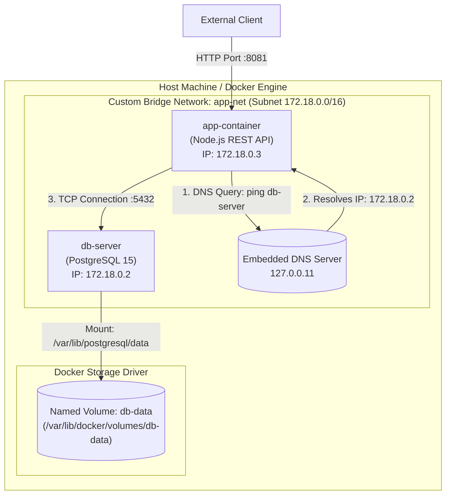

# Báo cáo Thực hành DevOps - Session 10: Bài 4
## Thiết lập Custom Network & Named Volume bằng Docker CLI

- **Học viên:** Đào Trọng Trí
- **Mã sinh viên:** PTIT062
- **Lớp:** DevOps / Cloud Native Engineering
- **Bài tập:** Kết nối cụm 2 container (Node.js Backend API + PostgreSQL) qua Custom Network và lưu trữ dữ liệu bền vững với Named Volume

---

## 1. Mục tiêu và Bối cảnh
- **Custom Bridge Network:** Tạo mạng cầu nối tùy chỉnh (`app-net`) để kích hoạt cơ chế Docker Embedded DNS, cho phép các container giao tiếp thông suốt qua tên miền nội bộ (service hostname / container name) thay vì phụ thuộc vào địa chỉ IP động dễ thay đổi.
- **Named Volume:** Sử dụng Docker Named Volume (`db-data`) để tách biệt dữ liệu cơ sở dữ liệu khỏi vòng đời ngắn ngủi (ephemeral lifecycle) của container. Đảm bảo dữ liệu không bị thất thoát khi container bị dừng, xóa hoặc nâng cấp phiên bản.
- **Tự động hóa:** Toàn bộ quy trình khởi tạo, kết nối, kiểm tra DNS resolution và thực nghiệm Data Persistence được tự động hóa qua kịch bản `commands.sh`.

---

## 2. Kiến trúc Hệ thống (Mermaid Diagram)



---

## 3. Cấu trúc thư mục
```text
SS10_HW04_DaoTrongTri_PTIT062/
├── commands.sh         # Script bash thực thi toàn bộ luồng thao tác tự động
└── README.md           # Báo cáo kỹ thuật phân tích kết quả & bằng chứng thực nghiệm
```

---

## 4. Các bước Thực hiện và Lệnh tương ứng

1. **Tạo Custom Bridge Network:**
   ```bash
   docker network create --driver bridge app-net
   ```
2. **Tạo Named Volume lưu trữ dữ liệu:**
   ```bash
   docker volume create db-data
   ```
3. **Khởi chạy container PostgreSQL Database (`db-server`):**
   ```bash
   docker run -d \
     --name db-server \
     --network app-net \
     -v db-data:/var/lib/postgresql/data \
     -e POSTGRES_USER=myuser \
     -e POSTGRES_PASSWORD=mypassword \
     -e POSTGRES_DB=mydb \
     postgres:15-alpine
   ```
4. **Khởi chạy container Web Backend (`app-container`):**
   ```bash
   docker run -d \
     --name app-container \
     --network app-net \
     -e DB_HOST=db-server \
     -e DB_PORT=5432 \
     -e DB_USER=myuser \
     -e DB_PASSWORD=mypassword \
     -e DB_NAME=mydb \
     -p 8081:3000 \
     hw-backend:v1
   ```
5. **Kiểm tra phân giải DNS nội bộ (DNS Resolution):**
   ```bash
   docker exec app-container ping -c 2 db-server
   ```
6. **Thực nghiệm tính toàn vẹn và bền vững của dữ liệu (Data Persistence):**
   - Thêm bảng `users` và chèn 2 bản ghi dữ liệu mẫu.
   - Xóa cưỡng bức container cơ sở dữ liệu: `docker rm -f db-server`.
   - Khởi chạy một container PostgreSQL hoàn toàn mới gắn cùng volume `db-data`.
   - Truy vấn xác minh dữ liệu vẫn còn nguyên vẹn.

---

## 5. Nhật ký Lệnh Thực thi từ Terminal Thực tế

### 5.1. Kết quả chạy script `commands.sh`
```text
=== BƯỚC 1: TẠO CUSTOM BRIDGE NETWORK VÀ NAMED VOLUME ===
5a27f0d136a67ac8b3afd77d5e839652ab1e60e4145efeae35b38bbd1e387a07
[✓] Tạo Custom Bridge Network: app-net
db-data
[✓] Tạo Named Volume: db-data

=== BƯỚC 2: KHỞI CHẠY POSTGRESQL DATABASE CONTAINER (db-server) ===
Status: Downloaded newer image for postgres:15-alpine
f7791d4b7200c675dc2b1f14b656793c7e15913e380a2c32685d16c49f1c1fb8
[✓] Container db-server đã khởi chạy và kết nối vào network app-net

=== BƯỚC 3: KHỞI CHẠY BACKEND CONTAINER KẾT NỐI VÀO app-net ===
a4f8882fd3ed5154c19abb64e4f5cfe195d0bf03483ee43721a161f45af123b5
[✓] Container app-container đã khởi chạy và tham gia app-net

=== BƯỚC 4: KIỂM TRA DNS RESOLUTION TRÊN CUSTOM NETWORK ===
Kiểm tra danh sách networks:
5a27f0d136a6   app-net   bridge    local
Kiểm tra danh sách volumes:
local     db-data
Kiểm tra phân giải hostname db-server từ app-container:
PING db-server (172.18.0.2): 56 data bytes
64 bytes from 172.18.0.2: seq=0 ttl=64 time=0.363 ms
64 bytes from 172.18.0.2: seq=1 ttl=64 time=0.145 ms

--- db-server ping statistics ---
2 packets transmitted, 2 packets received, 0% packet loss
round-trip min/avg/max = 0.145/0.254/0.363 ms

=== BƯỚC 5: TEST DATA PERSISTENCE TRÊN NAMED VOLUME ===
Chờ PostgreSQL sẵn sàng...
Tạo bảng 'users' và thêm dữ liệu kiểm thử vào PostgreSQL:
CREATE TABLE
INSERT 0 2
Dữ liệu hiện tại trong database:
 id |   username    |        email         |        created_at         
----+---------------+----------------------+---------------------------
  1 | daotrongtri   | trongtri@example.com | 2026-10-13 17:01:53.74516
  2 | devops_tester | tester@example.com   | 2026-10-13 17:01:53.74516
(2 rows)

=== BƯỚC 6: XÓA CỨNG CONTAINER DB VÀ TÁI TẠO ĐỂ KIỂM CHỨNG LƯU TRỮ BỀN VỮNG ===
Đang xóa cứng container db-server (docker rm -f db-server)...
db-server
Khởi chạy container PostgreSQL mới gắn cùng volume db-data cũ...
3b5ceefcec6edb0b2f7ede429f51013afd9d9404ec6fa24b257f5e74ded359da
Chờ PostgreSQL mới sẵn sàng...
Xác minh dữ liệu trong container mới (Data Persistence Verification):
 id |   username    |        email         |        created_at         
----+---------------+----------------------+---------------------------
  1 | daotrongtri   | trongtri@example.com | 2026-10-13 17:01:53.74516
  2 | devops_tester | tester@example.com   | 2026-10-13 17:01:53.74516
(2 rows)

=== HOÀN TẤT BÀI 4 THÀNH CÔNG ===
```

### 5.2. Kết quả kiểm tra mạng (`docker network inspect app-net`)
```json
[
    {
        "Name": "app-net",
        "Id": "5a27f0d136a67ac8b3afd77d5e839652ab1e60e4145efeae35b38bbd1e387a07",
        "Driver": "bridge",
        "IPAM": {
            "Config": [
                {
                    "Subnet": "172.18.0.0/16",
                    "Gateway": "172.18.0.1"
                }
            ]
        },
        "Containers": {
            "3b5ceefcec6edb0b2f7ede429f51013afd9d9404ec6fa24b257f5e74ded359da": {
                "Name": "db-server",
                "IPv4Address": "172.18.0.2/16"
            },
            "a4f8882fd3ed5154c19abb64e4f5cfe195d0bf03483ee43721a161f45af123b5": {
                "Name": "app-container",
                "IPv4Address": "172.18.0.3/16"
            }
        }
    }
]
```

---

## 6. Hướng dẫn Chụp ảnh Minh chứng (Evidence Collection)

> **Hướng dẫn cho sinh viên:**
> 1. Mở Terminal và kết nối SSH vào máy chủ Linux:
>    ```bash
>    ssh devopsg5@103.72.57.148
>    ```
> 2. Chạy lệnh kiểm tra DNS resolution giữa 2 container:
>    ```bash
>    docker exec app-container ping -c 2 db-server
>    ```
> 3. Chạy lệnh kiểm tra truy vấn dữ liệu từ container PostgreSQL:
>    ```bash
>    docker exec db-server psql -U myuser -d mydb -c "SELECT * FROM users;"
>    ```
> 4. Chụp ảnh màn hình hiển thị cả 2 lệnh trên (ping thành công 0% packet loss và bảng dữ liệu `users` nguyên vẹn).
> 5. Dán ảnh vào vị trí placeholder bên dưới.

### Minh chứng ảnh chụp:
`ImgEx: [Dán ảnh chụp màn hình kiểm tra ping DNS resolution và truy vấn data persistence tại đây]`
